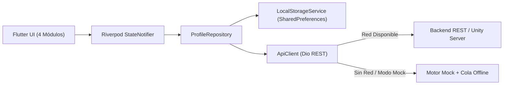

# 🦍 Jungle Party: Gorilimpiadas Companion App (`gorilla_escape_companion`)

**Documentación Técnica Oficial, Funcionalidades y Aportes al Ecosistema del Proyecto**  
*Compañero Móvil Independiente (Flutter 3.x / Dart 3.x) para el Party Game Físico "Gorilla Escape: Gorilimpiadas / Jungle Party"*

---

## 📑 Índice
1. [Resumen Ejecutivo y Propósito](#1-resumen-ejecutivo-y-propósito)
2. [Aportes Estratégicos y Técnicos al Proyecto Principal](#2-aportes-estratégicos-y-técnicos-al-proyecto-principal)
3. [Identidad Visual y Experiencia de Usuario (UX/UI)](#3-identidad-visual-y-experiencia-de-usuario-uxui)
4. [Arquitectura de Software y Stack Tecnológico](#4-arquitectura-de-software-y-stack-tecnológico)
5. [Documentación Detallada de Funcionalidades por Módulo](#5-documentación-detallada-de-funcionalidades-por-módulo)
6. [Contrato de Integración REST y Estrategia Offline-First](#6-contrato-de-integración-rest-y-estrategia-offline-first)
7. [Guía de Instalación, Emuladores y Repositorio Git](#7-guía-de-instalación-emuladores-y-repositorio-git)

---

## 1. Resumen Ejecutivo y Propósito

**`gorilla_escape_companion`** (*Jungle Party: Gorilimpiadas Companion App*) es una aplicación móvil multiplataforma (Android / iOS) desarrollada en **Flutter y Dart** concebida para extender la experiencia del videojuego principal en Unity (**Gorilla Escape: Gorilimpiadas**) hacia el dispositivo personal de cada jugador.

Mientras el juego principal en PC/Consola coordina la partida grupal en pantalla grande, la **Companion App** actúa como el **centro de identidad atlética, enciclopedia interactiva, simulador físico de entrenamiento con sensores reales y estudio social de trofeos**, permitiendo a los jugadores interactuar con el universo de la Isla Gorila antes, durante y después de cada sesión de juego.

---

## 2. Aportes Estratégicos y Técnicos al Proyecto Principal

La incorporación de `gorilla_escape_companion` aporta valor tangible en cinco dimensiones clave del proyecto:

### 2.1. Extensión de la Experiencia (*Second-Screen & Pre/Post-Game Engagement*)
- **Antes de la partida:** Los jugadores aprenden las reglas exactas, descubren la narrativa del Náufrago y practican sus movimientos físicos en el *Dojo de la Selva* sin necesidad de tener encendido el servidor de Unity.
- **Durante la partida:** Cada atleta consulta su marcador detallado frame por frame (*Banana Bowling*) o intento por intento (*Coconut Throw*), liberando espacio visual en la pantalla principal de Unity.
- **Después de la partida:** El *Jungle Photo Booth* transforma los récords obtenidos en tarjetas gráficas listas para compartirse en redes sociales y WhatsApp.

### 2.2. Reducción de la Curva de Aprendizaje Motriz (Calibración Biomecánica)
- En un *party game* controlado por movimiento, el principal obstáculo para nuevos jugadores es comprender cuánta fuerza aplicar y en qué ángulo inclinar el teléfono.
- El **Dojo de la Selva** replica exactamente las ecuaciones físicas del motor del juego ($\text{phonePower} = |\vec{\omega}_{\text{gyro}}| + 7 \cdot |\vec{a}_{\text{lineal}}|$ y ángulo óptimo de $40^\circ\text{--}45^\circ$), entrenando la memoria muscular del jugador en tiempo real.

### 2.3. Arquitectura Desacoplada y Resiliencia *Offline-First*
- **Repositorio Git Independiente:** Permite evolucionar, compilar y desplegar el cliente móvil con su propio ciclo de vida CI/CD sin acoplar dependencias móviles al repositorio de Unity.
- **Tolerancia total a fallos de red:** Gracias al motor de persistencia local y fallback **Mock automático**, la aplicación es 100% funcional en exhibiciones, salones de clase o demos donde el servidor backend no esté disponible, encolando las peticiones `POST` para sincronizarlas cuando vuelva la conexión.

### 2.4. Cohesión Narrativa y Accesibilidad Multimodal
- Integra el lore oficial de la Isla Gorila mediante un **Cómic Interactivo de 5 capítulos** con síntesis de voz en español (`flutter_tts`), haciendo accesible la historia y las reglas tanto de forma visual como auditiva.

### 2.5. Identidad Persistente del Jugador
- Genera y conserva un **UUID v4 único** por dispositivo junto con las preferencias ergonómicas del jugador (como su **Mano Dominante: Diestro, Zurdo o Ambas**), facilitando su registro inmediato ante el servidor REST (`/api/v1/players`).

---

## 3. Identidad Visual y Experiencia de Usuario (UX/UI)

El sistema de diseño ([jungle_theme.dart](lib/core/theme/jungle_theme.dart) y [jungle_glass_card.dart](lib/core/widgets/jungle_glass_card.dart)) implementa la estética **Selva Tropical / Arcade**:

| Elemento Visual | Especificación Técnica | Propósito en la Interfaz |
| :--- | :--- | :--- |
| **Fondo Principal** | `#071D22` y `#0B3432` | Gradiente nocturno selvático de alto contraste (Dark Mode nativo). |
| **Superficies Glass** | `#0C3437` + `BackdropFilter` | Tarjetas translúcidas con desenfoque gaussiano (`sigma: 10`) y bordes de `24px–28px`. |
| **Acento Primario** | `#26E0CF` (Turquesa/Cyan) | Indicadores activos, telemetría de sensores y navegación principal. |
| **Acento Secundario** | `#FFD13D` (Oro Kong) | Trofeos, Strikes (`X`), récords históricos y coronas de campeón. |
| **Alerta / Peligro** | `#FF786F` (Coral) | Tiros nulos, faltas y alerta de caída al río (`danger >= 0.6`). |
| **Texto Secundario** | `#A8C4C2` (Salvia Claro) | Subtítulos, metadatos técnicos y etiquetas de sensores. |
| **Tipografía** | `Lilita One` & `Nunito Sans` | Títulos estilo display cartoon grueso y lectura técnica limpia. |
| **Respuesta Táctil** | `HapticFeedback` nativo | Vibración diferenciada en botones, alertas de peligro y récords. |

---

## 4. Arquitectura de Software y Stack Tecnológico

El proyecto sigue una arquitectura **Feature-First combinada con Clean Architecture** (`domain`, `data`, `presentation`), garantizando separación de responsabilidades, testabilidad y escalabilidad:

```text
lib/
├── main.dart                                      # Inicialización, ProviderScope y BottomNavigationBar (4 módulos)
├── core/
│   ├── network/api_client.dart                    # Cliente HTTP Dio + Fallback Mock automático y cola Offline
│   ├── storage/local_storage_service.dart         # Persistencia local (SharedPreferences): UUID, caché y récords
│   ├── theme/jungle_theme.dart                    # Sistema de diseño Selva Tropical/Arcade y Google Fonts
│   └── widgets/jungle_glass_card.dart             # Componentes Glassmorphism, badges y botones hápticos
└── features/
    ├── profile/                                   # MÓDULO 1: Perfil de Atleta, Avatar y Scoreboard REST
    │   ├── domain/models/athlete_models.dart      # Entidades: AthleteProfile, BowlingFrameScore, CoconutThrowAttempt
    │   ├── data/profile_repository.dart           # Orquestador REST + Caché local + Cola de sincronización
    │   └── presentation/
    │       ├── providers/profile_provider.dart    # Gestión de estado reactivo con Riverpod (StateNotifier)
    │       ├── screens/profile_screen.dart        # Vista principal de Perfil, configuración REST y pestañas
    │       └── widgets/scoreboard_cards.dart      # Tablas de Bowling, Coconut Throw, Combos y Gráfica Histórica
    ├── codex/                                     # MÓDULO 2: Códice de la Isla, Cómic y 9 Disciplinas
    │   ├── domain/models/codex_models.dart        # Modelos de Viñetas, Biografías y Fichas Técnicas
    │   ├── data/codex_static_data.dart            # Base de conocimiento oficial de la Isla Gorila
    │   └── presentation/screens/codex_screen.dart # Visor de cómic con TTS, biografías y buscador de reglas
    ├── dojo/                                      # MÓDULO 3: Dojo de la Selva (Entrenamiento con Sensores)
    │   └── presentation/screens/dojo_screen.dart  # Laboratorio de Swing y minijuego 2D Tronco en el Río
    └── photobooth/                                # MÓDULO 4: Jungle Photo Booth (Tarjetas de Campeón)
        └── presentation/screens/photobooth_screen.dart # Cámara/Galería, Marcos, Stickers y exportación PNG
```

### Paquetes Principales Utilizados
- **Gestión de Estado:** `flutter_riverpod` (`^2.6.1`) — Inyección de dependencias y estado reactivo predecible.
- **Sensores Físicos IMU:** `sensors_plus` (`^6.1.0`) — Lectura en tiempo real de `AccelerometerEvent` y `GyroscopeEvent`.
- **Red y Persistencia:** `dio` (`^5.7.0`), `shared_preferences` (`^2.3.3`) y `uuid` (`^4.5.1`).
- **Narración y Multimedia:** `flutter_tts` (`^4.2.0`), `image_picker` (`^1.1.2`), `share_plus` (`^10.1.2`) y `path_provider` (`^2.1.5`).

---

## 5. Documentación Detallada de Funcionalidades por Módulo

### 🏅 Módulo 1: Perfil de Atleta, Personalización de Avatar y Marcador Personal
1. **Registro e Identidad del Jugador:**
   - Configuración de **Nombre Completo**, **Apodo (`nickname`)**, **Mano Dominante** (*Diestro*, *Zurdo*, *Ambas*) y selección entre **6 Avatares Temáticos** (*Gorila Guardián, Rey Kong, Náufrago Explorador, Mono Capuchino, Gorila Boxeador, Bebé Dormilón*).
   - Generación automática de `UUID v4` persistente y envío mediante `POST /api/v1/players`.
2. **Marcador Personal en Vivo e Histórico (*Scoreboard Dashboard*):**
   - **Banana Bowling (Tabla Oficial de 10 Frames):** Visualización interactiva de los 10 frames con tiros 1 y 2, simbología oficial de Strike (`X`) y Spare (`/`), puntaje acumulado e inspección detallada al tocar cada frame.
   - **Coconut Throw (Shot Put - 3 Intentos):** Registro de los 3 lanzamientos reglamentarios indicando distancia en metros (`m`), ángulo de salida en grados (`°`), estado del tiro (*Válido* vs. *Nulo/Falta*) y distinción automática del Mejor Intento (`BEST ATTEMPT`).
   - **Indicadores Arcade (*Jungle Drums, Gorilla Whack y Coconut Slice*):** Tarjetas de alto rendimiento con puntaje máximo (`highScore`), mejor racha de combos (`bestCombo`) y porcentaje de precisión (`accuracyPercent`).
   - **Evolución Histórica:** Gráfica vectorial renderizada con `CustomPainter` que traza la curva de progreso del atleta a través de sus partidas registradas vía REST y caché local.

---

### 📖 Módulo 2: Códice de la Isla y Cómic Interactivo (Lore, Reglas y Tutoriales)
1. **Visor de Cómic Interactivo (Modo Historia):**
   - Carrusel animado con las **5 viñetas oficiales**:
     1. *Tormenta en Altamar* (El naufragio nocturno).
     2. *Despertar en la Arena* (Llegada a la mítica Isla Gorila).
     3. *El Encuentro* (Aparición de la tribu y el colosal Rey Kong).
     4. *El Desafío de Kong* (La promesa de la balsa de bambú si supera las Gorilimpiadas).
     5. *Las Pruebas Sagradas* (*Coconut Throw, Coconut Slice, Gorilla Whack y Banana Bowling*).
   - **Narrador de Voz y Ambiente (`flutter_tts`):** Lectura sintetizada en español con botón Play/Stop y modo de *Auto-Voz* al deslizar entre viñetas.
2. **Biografías Ilustradas de Personajes:**
   - Fichas de **Rey Kong**, **El Náufrago**, **Gorila Guardián**, **Bebé Gorila Dormilón** y **Monos Capuchinos Traviesos**, incluyendo rol, movimiento especial, arena favorita y barras comparativas de atributos.
3. **Enciclopedia Técnica de las 9 Disciplinas (con Buscador en Tiempo Real):**
   - Documenta *Banana Bowling, Coconut Throw, Coconut Slice, Gorilla Whack, Gorilla Boxing, Jungle Baseball, Jungle Drums, Log Balance* y *Jungle Keeper*.
   - Especifica qué sensores utiliza cada juego, cómo se sujeta el teléfono, secretos del Dojo y las **reglas exactas de victoria en Modo Historia**:
     - *Coconut Throw:* Meta de **25.0 m** con ángulo óptimo de **40° a 45°**.
     - *Coconut Slice:* Meta de **1,600 pts** y **derrota instantánea** si se corta al Bebé Gorila Dormilón.
     - *Gorilla Whack:* Meta de **10 golpes certeros**.
     - *Banana Bowling:* Meta de **80 puntos** en 10 frames.

---

### 🥋 Módulo 3: Simulador de Entrenamiento en Solitario ("Dojo de la Selva")
Funciona de manera 100% *standalone* leyendo los sensores físicos del dispositivo móvil:
1. **Laboratorio de Swing (Bateo y Lanzamiento):**
   - Calcula en tiempo real la potencia combinada mediante la fórmula oficial:
     $$\text{phonePower} = |\vec{\omega}_{\text{gyro}}| + 7 \cdot |\vec{a}_{\text{lineal}}|$$
   - Calcula el ángulo de elevación ($\theta \in [5^\circ, 85^\circ]$) a partir de los ejes del acelerómetro.
   - **Velocímetro Radial y Clasificador:** Evalúa cada movimiento en tres zonas: *Armado (< 160)*, *Impulso Medio (160–280)* y *¡Lanzamiento Válido (> 280)!*, resaltando si el ángulo se encuentra en la ventana óptima de **40°–45°**.
   - **Gráfica de Curva de Swing:** Traza la curva dinámica del último swing comparándola contra las líneas de umbral de armado (`160`) y tiro válido (`280`). Incluye botón de simulación para pruebas en emulador.
2. **Reto de Equilibrio 2D ("Tronco en el Río" - *Log Balance Trainer*):**
   - Minijuego 2D con bucle físico a `20 Hz` donde el atleta debe cruzar un tronco de **15.0 metros** sobre un río con corriente variable.
   - Utiliza la inclinación lateral del acelerómetro (más botones táctiles auxiliares para emulador) para contrarrestar la inercia rotacional.
   - Cuando el nivel de riesgo supera el umbral crítico (`danger >= 0.6`), emite alertas visuales en color Coral (`#FF786F`) y pulsos de vibración háptica (`HapticFeedback.heavyImpact()`).

---

### 📸 Módulo 4: Cabina Fotográfica y Tarjetas de Campeón ("Jungle Photo Booth")
1. **Captura Multimodal y Fondos de Respaldo:**
   - Toma selfies con la cámara frontal/trasera o importa imágenes de la galería (`image_picker`), e incorpora **4 escenarios ilustrados de la Isla Gorila** para pruebas en emulador sin cámara física.
2. **Estudio de Personalización Selvática:**
   - **4 Marcos Temáticos:** *Bambú Tropical*, *Oro del Rey Kong*, *Náufrago Sobreviviente* y *Campeón de las Gorilimpiadas*.
   - **Stickers Interactivos:** Colocación libre con arrastre táctil (`onPanUpdate`), escalado por toque (`onTap`) y eliminación por pulsación larga (`onLongPress`) de *Cocos Partidos, Pinos Tótem, Guantes de Boxeo, Corona de Kong, Plátanos Dorados y Medallas*.
   - **Overlay Automático de Récord:** Inserta dinámicamente en la parte inferior de la tarjeta el `nickname`, el avatar del jugador, la disciplina seleccionada y el último gran récord registrado en su Perfil de Atleta.
3. **Exportación PNG de Alta Resolución:**
   - Renderiza el widget compuesto a una imagen PNG con `pixelRatio: 3.0` mediante `RepaintBoundary` y abre el menú nativo del sistema operativo (`share_plus`) para compartirla por WhatsApp o redes sociales.

---

## 6. Contrato de Integración REST y Estrategia Offline-First



| Método y Endpoint | Descripción | Comportamiento en Fallback Offline / Mock |
| :--- | :--- | :--- |
| `POST /api/v1/players` | Registra o actualiza el perfil del atleta (UUID, nombre, apodo, avatar, mano). | Guarda el perfil localmente y encola la petición en `pending_sync_queue_v1`. |
| `GET /api/v1/players` | Consulta la lista de atletas conectados a la sala. | Devuelve el perfil local acompañado de un roster simulado de competidores. |
| `GET /api/v1/minigames` | Descarga el catálogo oficial de las 9 disciplinas. | Sirve el catálogo local verificado de las 9 pruebas de las Gorilimpiadas. |
| `GET /api/v1/matches/{matchId}/results` | Obtiene los puntajes en vivo y la evolución histórica del `matchId`. | Genera marcadores realistas de 10 frames, tiros de coco, combos y gráfica histórica. |

---

## 7. Guía de Instalación, Emuladores y Repositorio Git

### 7.1. Inicializar Repositorio Git Independiente
```bash
git init
git branch -M main
git add .
git commit -m "feat: release gorilla_escape_companion mobile app"
git remote add origin https://github.com/tu-usuario/gorilla-escape-companion.git
git push -u origin main
```

### 7.2. Iniciar Emulador desde la Terminal y Ejecutar
```bash
# 1. Instalar dependencias
flutter pub get

# 2. Listar emuladores disponibles y encender uno (ej. Medium_Phone_API_35)
flutter emulators
flutter emulators --launch Medium_Phone_API_35

# 3. Verificar dispositivos activos y ejecutar la aplicación
flutter devices
flutter run

# 4. Ejecutar análisis estático y pruebas automatizadas
flutter analyze
flutter test
```
